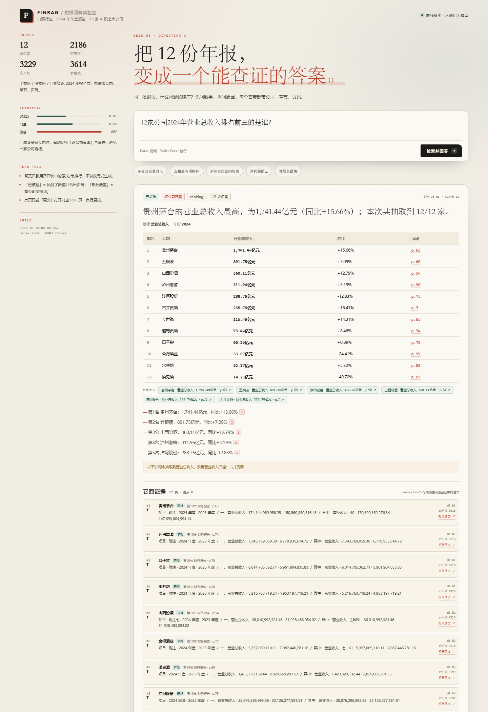

# 白酒财报问答 · 12 家 A 股上市公司 2024 年报

> 第三周作业 · 方向 A：下载财报，做一个问答知识库。
>
> 同一批财报，什么问题该建库，什么问题该微调？这个仓库用 12 份白酒年报、10 道评测题和一条可核验的检索链路，给出工程上的回答。

- **公开仓库**：https://github.com/batmanlzx/week3-finrag



## 交付物

| 内容 | 位置 |
|---|---|
| 代码仓库 | 本目录（`src/`、`app.py`、`templates/`、`static/`） |
| 问答页面截图 | [`docs/screenshot.png`](docs/screenshot.png) |
| 一页结论（PDF / PNG / Markdown） | [`docs/conclusion.pdf`](docs/conclusion.pdf)、[`docs/conclusion.png`](docs/conclusion.png)、[`docs/conclusion.md`](docs/conclusion.md) |
| 10 题逐题记录（召回块、对错、错在哪） | [`eval/report.md`](eval/report.md)、[`eval/results.jsonl`](eval/results.jsonl)、[`eval/results.csv`](eval/results.csv) |
| 题目与金标准 | [`eval/questions.json`](eval/questions.json) |
| 抽取统计 | [`data/meta/extract_summary.json`](data/meta/extract_summary.json) |

## 数据

- 行业：白酒（A 股），同一报告期：2024 年年度报告。
- 来源：巨潮资讯（CNINFO）披露全文，下载脚本记录 PDF URL、公告日期、字节数与 SHA-256。
- 12 家公司，2,186 页，3.64M 字：

| 代码 | 公司 | 页数 | 代码 | 公司 | 页数 |
|---|---|---|---|---|---|
| 600519 | 贵州茅台 | 143 | 603369 | 今世缘 | 173 |
| 000858 | 五粮液 | 147 | 603198 | 迎驾贡酒 | 218 |
| 000568 | 泸州老窖 | 195 | 603589 | 口子窖 | 231 |
| 600809 | 山西汾酒 | 167 | 600702 | 舍得酒业 | 202 |
| 002304 | 洋河股份 | 173 | 600779 | 水井坊 | 205 |
| 000596 | 古井贡酒 | 180 | 000799 | 酒鬼酒 | 152 |

最终切块：**3,229 个文本块 + 3,614 个表格块 = 6,843 块**。每块都带公司、章节、页码；表格块额外带表题和页码上下文。

## 方法

```text
CNINFO 公告 API
  └─ 下载 2024 年报 PDF（12 份，带 manifest / sha256）
       └─ PyMuPDF 逐页抽取
            ├─ 正文：按句切块，约 820 字，120 字重叠
            └─ 表格：有框线表格 → 表头 + 行列 → Markdown 管道表
                 └─ 每块写入 company / section / page_start / page_end / type
                      ├─ BM25：jieba.lcut_for_search + 数字串
                      └─ 向量：字符 2–4 gram TF-IDF → TruncatedSVD(256) → L2
                           └─ RRF 融合（BM25 0.45 / 向量 0.55）
                                ├─ 单公司：直接检索，按公司硬过滤
                                ├─ 多公司：逐公司召回 → 合并 → 每公司最多 3 块
                                └─ 数值题：第二阶段「指标 + 表名」锚定查询
                                     └─ 抽取式答案 + 页码出处（不调用 LLM）
```

几个关键实现：

- **表格按行列还原**：PyMuPDF `find_tables()` 抽出单元格后，压缩 PDF 网格里的空列，合并被换行拆开的行标签，处理「元 / 万元 / 亿元」单位和「合并 vs 母公司」页码顺序。
- **章节元数据**：`第X节` 允许标题换行、一页两节；目录页用点号密度过滤。
- **混合检索**：BM25 负责专有名词与数字，LSA 向量负责近义改写；RRF 避免两路分数量纲不一致。
- **全景题**：问题出现「各家 / 12 家 / 排名 / 最高 / 最低」时，先按公司逐家召回，再按公司内排名轮转合并，避免头部公司占满 top-k。
- **两阶段数值定位**：先用问题级混合检索找章节，再用「合并资产负债表 + 合同负债 + 期末余额」这类锚定查询回到主表。这是 q07 仍能答对的原因，也是结论里“检索到 ≠ 答对”的来源。
- **答案抽取式**：`src/qa.py` 只输出召回块中的表格行/原文句，不调用大模型；每条结论带 `[n]` 和页码链接，可点开 PDF 对应页复核。

## 页面

- 首页默认问「12 家公司 2024 年营业总收入排名前三的是谁？」，自动给出 12 行排名表、数值定位块和召回证据。
- 输入框支持 10 道评测题和自定义问题；答案卡展示状态（已核验/部分覆盖/未命中）、指标、年份、表格、页码。
- 「召回证据」显示 dense / BM25 名次与 RRF 分数；「数值定位」显示第二阶段真正取数的块。
- 每条页码可打开 `/pdf/<code>#page=N`。

本地启动：

```powershell
cd week3-finrag
python app.py
# http://127.0.0.1:7860
```

## 10 题评测

题目、金标准、逐题召回块与错因在 [`eval/report.md`](eval/report.md)。摘要：

| 指标 | 结果 |
|---|---|
| 数值正确 | **10 / 10** |
| 单公司题金标准页进入问题级 top-12 | **7 / 8** |
| 数值块进入问题级 top-12 | **9 / 10** |
| 跨公司排序 / 极值 | **2 / 2** |

答得好的：

- 单公司 + 主表科目：营业总收入、归母净利润、经营现金流、研发投入（q01/q02/q04/q05/q08）。
- 同一张主要会计数据表里的双指标（q06）。
- 跨公司营收前三、归母净利润增速最高/最低（q09/q10）。

翻车/脆弱点：

- **q07 今世缘合同负债**：问题级 top-12 全是附注里的同名「合同负债 / 期末余额」表，没有 p.62 合并资产负债表；靠第二阶段锚定查询才拿到 15.93 亿元。答案对，检索路径脆。
- **q03 泸州老窖合同负债**：先命中 p.25 管理层讨论表，而不是 p.87 合并资产负债表；两处数值一致，但口径解释依赖表头识别。
- **q02 五粮液经营现金流**：曾被 p.8 分季度表的 Q1 值（5.16 亿元）干扰；系统用「四列季度值 + 无年度表头」规则剔除了它。
- **q09 古井贡酒**：营业总收入行未被抽取器命中，回退营业收入口径，已在备注披露。

## 结论

完整一页见 [`docs/conclusion.pdf`](docs/conclusion.pdf)。核心判断：

- **事实题建库**：单/跨公司数值、同比、排名、占比，答案在表里、可枚举、可核验；检索 + 表格抽取足够，微调不增加事实可靠性。
- **判断题微调**：「为什么合同负债下降」「预收款变化说明什么」需要行业语义、因果链和多步判断；检索只能给证据，不能替代判断。
- **口径题靠结构规则**：营业总收入 vs 营业收入、合并 vs 母公司，不是语言能力问题，是表名/报表范围元数据问题。
- **表格结构决定上限**：多行表头、空列、单位、两套报表，是数值题真正的胜负手；向量擅长“哪一页”，不擅长“哪一行”。

## 复现

依赖 Python 3.12。仓库自带离线依赖目录 `.pylibs/` 与 `.vendor/jieba_pkg/`，`bootstrap.py` 会自动加入 `sys.path`；在干净环境也可以：

```powershell
python -m pip install -r requirements.txt
```

完整链路：

```powershell
cd week3-finrag

# 1. 下载 12 份 2024 年报（CNINFO，带 manifest / sha256）
python src/download.py

# 2. 抽文字 + 还原表格 + 带元数据切块
python src/extract.py

# 3. 建 BM25 + 向量索引
python src/index.py

# 4. 跑 10 题评测，生成 eval/report.md
python src/evaluate.py

# 5. 启动问答页面
python app.py
```

测试：

```powershell
python tests/test_smoke.py
```

> `data/raw_pdf/`、`data/processed/`、`data/index/`、`.pylibs/`、`.vendor/` 已在 `.gitignore` 中；首次 clone 后按上面 1–3 步重建。页面截图与一页结论已随仓库提交。

## 目录

```text
week3-finrag/
├─ app.py                  Flask 页面 / API / PDF 路由
├─ bootstrap.py            离线依赖路径
├─ config/companies.json   12 家公司与别名
├─ src/
│  ├─ config.py            路径、公司注册表、指标同义词
│  ├─ download.py          CNINFO 公告查询与 PDF 下载
│  ├─ extract.py           PDF 文字/表格抽取、章节识别、切块
│  ├─ index.py             BM25 + LSA 索引
│  ├─ qa.py                检索、全景召回、表格事实抽取、答案
│  └─ evaluate.py          10 题评测与报告
├─ templates/index.html
├─ static/app.css, app.js
├─ eval/questions.json     10 题 + 金标准
├─ eval/report.md          逐题召回块 / 对错 / 错因
├─ docs/screenshot.png     页面截图
├─ docs/conclusion.pdf     一页结论
└─ tests/test_smoke.py
```

## 设计取舍与局限

- **不用神经嵌入**：为了保证离线可复现，向量侧用字符 n-gram TF-IDF + LSA（256 维），不是 sentence-transformers。语义泛化弱于神经模型，但专有名词、数字、表格行匹配更可控；结论里也把它当作“工程基线”而不是最优解。
- **不调用大模型**：答案严格抽取，避免幻觉，也便于逐题核对；代价是语言不够自然，复杂归因题答不了。
- **表格抽取是启发式**：合并单元格、跨页表、扫描件仍可能失败；本项目未做 OCR。q07 的检索失败就是这类问题的直接证据。
- **评测只有 10 题 / 12 家公司 / 单一年份**：结论应视为这套语料与这套题目的工程判断，不是行业定论。

## 参考

- 巨潮资讯：<https://www.cninfo.com.cn/>
- 上海证券交易所：<https://www.sse.com.cn/>
- 深圳证券交易所：<https://www.szse.cn/>
- PyMuPDF 文档：<https://pymupdf.readthedocs.io/>
